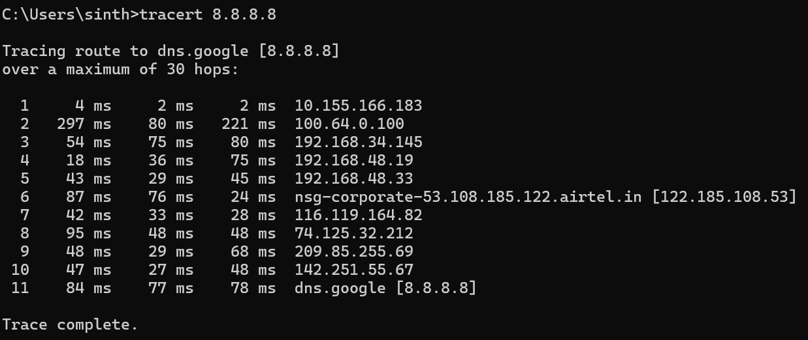
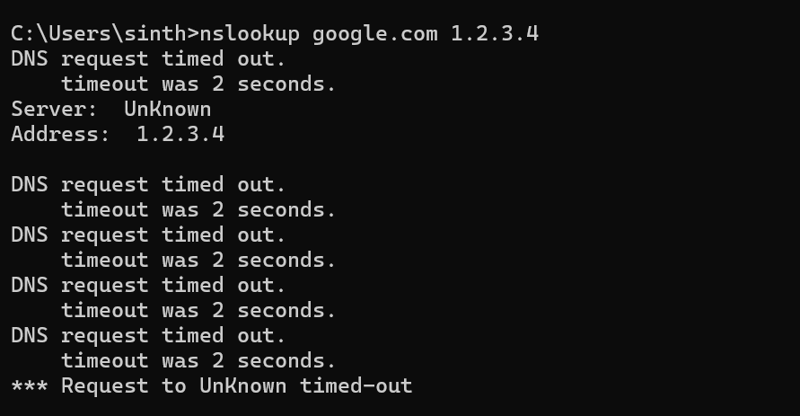
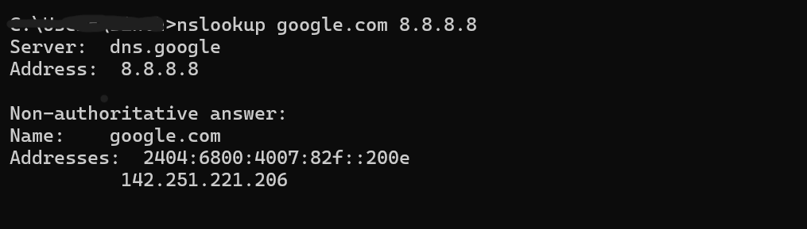
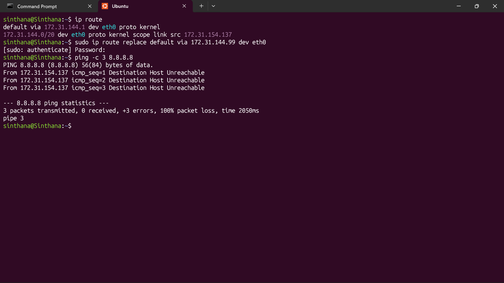
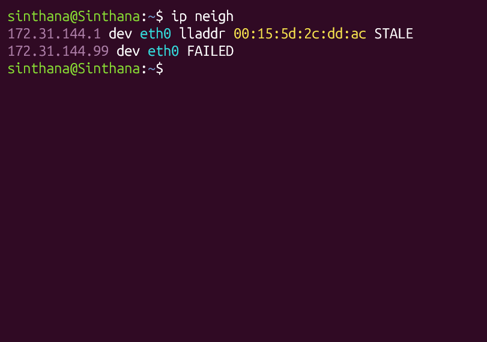
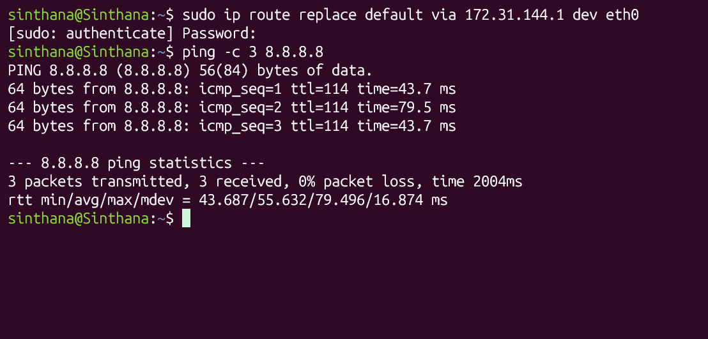

# Network Troubleshooting: Break and Fix

## Goal
Learn to diagnose common network problems by breaking things on purpose and fixing them: reading a traceroute, spotting a DNS failure, and finding a wrong default gateway.

## Environment
- Host: Windows (Command Prompt), connected through a mobile hotspot
- Linux: Ubuntu on WSL2
- Tools: `tracert`, `nslookup`, `ip route`, `ping`, `ip neigh`

## Architecture
```
Ubuntu (WSL) --> gateway 172.31.144.1 --> Windows host --> hotspot --> carrier network --> Internet (8.8.8.8)
```

## Steps

### Part 1: Read a traceroute (Windows)
Ran `tracert 8.8.8.8` to see the path to Google DNS.

| Hop | Address | Meaning |
|---|---|---|
| 1 | 10.155.166.183 | My gateway (hotspot) |
| 2 | 100.64.0.100 | Carrier network (CGNAT range 100.64.x.x), slowest hop at about 200-290 ms |
| 3-5 | 192.168.x.x | Private addresses inside the provider's network |

Hop 2 was slow, but later hops were faster (33-58 ms). So the slow hop was just that router answering probes slowly, not a real fault.

### Part 2: Break DNS (Windows)
Asked a made-up DNS server, then a real one:
```
nslookup google.com 1.2.3.4
nslookup google.com 8.8.8.8
```

| | Wrong DNS (1.2.3.4) | Correct DNS (8.8.8.8) |
|---|---|---|
| Symptom | "DNS request timed out" repeated, then "Request to UnKnown timed-out" | Returned IP addresses |
| Meaning | The server never answers | DNS works |
| Fix | Use a working DNS server | None needed |

### Part 3: Break the default gateway (Ubuntu on WSL)
1. Recorded the original route first: `ip route` showed `default via 172.31.144.1 dev eth0`.
2. Tested that internet worked: `ping -c 2 8.8.8.8`.
3. Broke it with a gateway that does not exist:
   ```
   sudo ip route replace default via 172.31.144.99 dev eth0
   ping -c 3 8.8.8.8
   ```
4. Checked the neighbour (ARP) table: `ip neigh`.
5. Restored the real gateway:
   ```
   sudo ip route replace default via 172.31.144.1 dev eth0
   ping -c 3 8.8.8.8
   ```

## Screenshots







## What broke and how I fixed it

| Problem | Symptom | Evidence | Fix |
|---|---|---|---|
| Wrong DNS server | `DNS request timed out` | nslookup got no answer from 1.2.3.4 | Use a working DNS server such as 8.8.8.8 |
| Wrong default gateway | `Destination Host Unreachable`, 100% packet loss | The error came from my own IP (172.31.154.137), and `ip neigh` showed `172.31.144.99 FAILED` | Set the default route back to 172.31.144.1 |

How I diagnosed the gateway problem:
- "Unreachable" coming from my own IP means the problem is on my own network segment, not further along the path.
- The ARP table confirmed it: nobody answered for 172.31.144.99, so its state was FAILED, while the real gateway was still known.
- After restoring the correct gateway, ping showed 0% packet loss.

## What I learned
- In a traceroute, one slow middle hop is not a verdict. Judge by whether the final hops stay slow.
- `100.64.x.x` addresses are carrier-grade NAT, used by mobile and ISP providers.
- "Destination Host Unreachable" from your own IP points to a local problem such as a wrong gateway. From a router's IP it points to a problem further along the path.
- `ip neigh` showing FAILED proves ARP got no reply.
- Always note the original settings (`ip route`) before breaking anything, so you can restore them.

## Cleanup
- Restored the original default route and confirmed 0% packet loss.
- No cloud resources were created in this lab.
- If anything had gone wrong, `wsl --shutdown` in PowerShell resets the VM.
