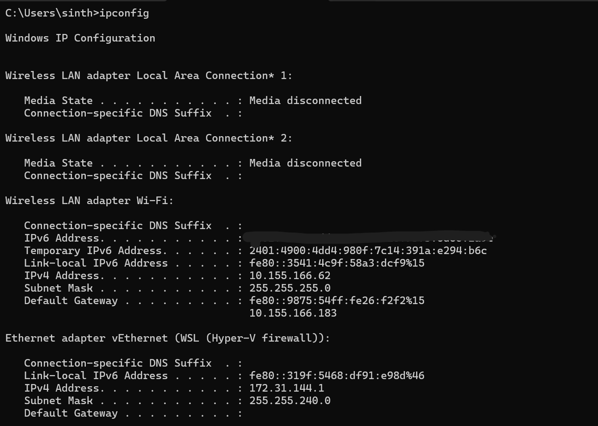

# Linux Setup (WSL) and IP Basics

## Goal
Set up a Linux environment on Windows using WSL, then learn to read network configuration on both sides (`ip a` on Linux, `ipconfig` on Windows) and test connectivity between them.

## Environment
- Host OS: Windows 11 (25H2, build 26200)
- Virtualization: enabled (checked in Task Manager)
- Linux: Ubuntu on WSL2
- Tools: `ip a`, `ipconfig`, `ping`

## Architecture
```
Ubuntu (WSL) 172.31.154.137  -->  Windows (vEthernet) 172.31.144.1  -->  Wi-Fi gateway 10.155.166.183  -->  Internet
```

## Steps
1. Checked Windows version with `winver` and confirmed virtualization is enabled in Task Manager (Performance > CPU).
2. Opened PowerShell as administrator and ran `wsl --install`, then restarted the PC.
3. Opened Ubuntu and created a Linux username and password.
4. Ran `ip a` in Ubuntu to read the Linux network configuration.
5. Ran `ipconfig` in PowerShell to read the Windows configuration.
6. Tested connectivity from Linux to Windows: `ping -c 4 172.31.144.1`.

## Screenshots




## What I found

| Item | Value | Meaning |
|---|---|---|
| Linux IP (eth0) | 172.31.154.137/20 | Private address on WSL's virtual network |
| Loopback | 127.0.0.1 | The machine talking to itself |
| Windows Wi-Fi IPv4 | 10.155.166.62 | Private address on my Wi-Fi network |
| Wi-Fi subnet mask | 255.255.255.0 (/24) | Network holds 10.155.166.x addresses |
| Wi-Fi default gateway | 10.155.166.183 | Exit from my local network |
| Windows address on the WSL network | 172.31.144.1 | Gateway for the Linux side |

All addresses above are private (10.x.x.x and 172.16-31.x.x ranges).

## Connectivity test
`ping -c 4 172.31.144.1` from Ubuntu:
- 4 packets sent, 4 received, **0% packet loss**
- Response time about 0.5-0.9 ms (very fast because both sides are inside the same PC)
- TTL 128, which suggests the reply came from Windows (Windows starts at 128, Linux usually at 64)

## What I learned
- WSL runs Linux inside Windows, and it is lighter than a full VirtualBox VM.
- `ip a` on Linux and `ipconfig` on Windows show the same kind of information: IP address, subnet mask and gateway.
- Linux inside WSL sits on its own small virtual network, and Windows acts as its gateway.
- Private ranges are 10.x.x.x, 172.16-31.x.x and 192.168.x.x.
- `ping` uses ICMP, and 0% packet loss with low `time=` values means the path is healthy.

## Cleanup
- No cloud resources were created, so there is nothing to delete and no billing risk.
