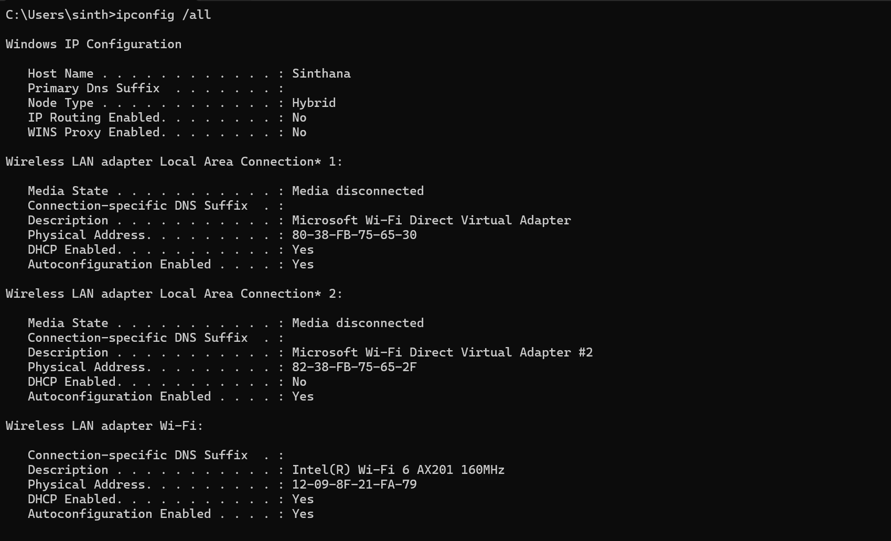

# Find My IP, Gateway and DNS (Private vs Public)

## Goal
Find the three key network settings on my PC (IP address, default gateway, DNS server), decide which addresses are private or public, and see how my private address relates to my public one.

## Environment
- Host OS: Windows 11, connected over Wi-Fi
- Linux: Ubuntu on WSL2
- Tools: `ipconfig /all`, a browser IP lookup site

## Architecture
```
Your PC 10.155.166.62  -->  Gateway 10.155.166.183  -->  Public IP (171.x.x.x)  -->  Internet
(private address)           (the exit door)               (address websites see)
```

## Steps
1. Ran `ipconfig /all` in Command Prompt.
2. Found the DNS Servers line under the Wireless LAN adapter Wi-Fi section.
3. Labelled each address as private or public using the private ranges.
4. Searched "what is my IP address" in a browser to find my public IP, then compared it with my private IP.

## Screenshots


## What I found

| Item | Value | Private or public? | Why |
|---|---|---|---|
| PC IP | 10.155.166.62 | Private | Inside 10.0.0.0 - 10.255.255.255 |
| Default gateway | 10.155.166.183 | Private | Inside the 10.x range |
| DNS server (IPv4) | 10.155.166.183 | Private | Inside the 10.x range |
| Linux (WSL) IP | 172.31.154.137 | Private | Inside 172.16.0.0 - 172.31.255.255 |
| Public IP (from browser) | starts with 171 | Public | Outside all private ranges |

The DNS server is the same address as the gateway. My router/hotspot also answers name lookups for me.

## Private IP ranges
| Range | From | To |
|---|---|---|
| 10.x.x.x | 10.0.0.0 | 10.255.255.255 |
| 172.16-31.x.x | 172.16.0.0 | 172.31.255.255 |
| 192.168.x.x | 192.168.0.0 | 192.168.255.255 |

## What I learned
- DNS is the phone book of the internet: it turns names like google.com into IP addresses.
- The gateway can also act as the DNS server, which is common on home routers and phone hotspots.
- Only part of the 172 range is private (172.16 to 172.31), not all of it.
- My PC has a private address, but websites see a different public address.
- The gateway swaps my private address for the public one on the way out. This is called NAT.
- With mobile data and hotspots, many customers can share one public IP.

## Cleanup
- No cloud resources were created, so there is nothing to delete and no billing risk.
