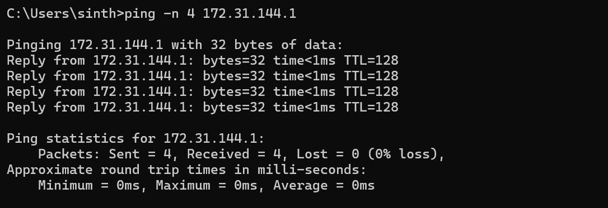

# Wireshark: Capture ARP and Ping

## Goal
Install Wireshark and use it to see what really happens on the network when I ping my gateway: the ARP exchange first, then the ICMP ping.

## Environment
- Host OS: Windows 11, connected over Wi-Fi (home network, 192.168.1.x)
- Tools: Wireshark 4.6.10, Npcap (capture driver), Command Prompt (`ipconfig`, `ping`)
- Display filter used: `arp || icmp`

## Architecture
```
My PC 192.168.1.2  --ARP: who has 192.168.1.1?-->  Gateway 192.168.1.1
My PC 192.168.1.2  <--ARP: 192.168.1.1 is at <MAC>--  Gateway 192.168.1.1
My PC 192.168.1.2  --ICMP ping-->  Gateway 192.168.1.1
```

## Steps
1. Downloaded Wireshark from the official site (wireshark.org) and installed it with the default options, including Npcap. I left the optional USBPcap unticked because I only needed network capture.
2. Started a capture on the Wi-Fi interface and applied the display filter `arp || icmp`.
3. Found my IP and gateway with `ipconfig`.
4. Pinged an address from Command Prompt and watched the packets in Wireshark.
5. Restarted the capture, pinged my real gateway with `ping -n 4 192.168.1.1`, and read the ARP and ICMP rows.

## Screenshots



## What I found

| Packet | What it means |
|---|---|
| ARP request: "Who has 192.168.1.1? Tell 192.168.1.2" | My PC shouts to everyone on the local network, asking who owns the gateway's IP |
| ARP reply: "192.168.1.1 is at <gateway MAC>" | The gateway answers with its MAC address |
| ICMP echo request and reply | The ping itself, which worked |
| ICMP "Destination unreachable (Port unreachable)" | Sent by the gateway when some program on my PC sent data to a port it does not use. The gateway is alive, so this is not a ping failure |

ARP came before the ping because my PC knew the gateway's IP but not its MAC. A Wi-Fi or Ethernet frame needs a MAC address, so ARP (IP to MAC) must happen first.

## What went wrong and how I fixed it

| Problem | Symptom | Cause | Fix |
|---|---|---|---|
| Confusing ICMP results | Saw "destination unreachable" rows in Wireshark and no ARP | My first ping targeted my own IP (192.168.1.2), not the gateway. A ping to yourself never leaves the PC, so no ARP is needed | Read the gateway address from `ipconfig` (192.168.1.1) and pinged that |
| "Unreachable" rows still showing | Red-looking "Port unreachable" rows | Background traffic from the gateway, not from my ping | Checked that the ping replies themselves were fine, then treated the rows as normal noise |

## What I learned
- ARP asks "who has this IP?" and learns the matching MAC address. It only works inside the local network and never crosses a router.
- ARP always comes before the first packet to a new local address.
- A ping to my own IP answers in under 1 ms and creates no ARP traffic.
- "Port unreachable" means the device is alive but nothing is listening on that port, so it is not the same as a broken network.
- A display filter like `arp || icmp` keeps a capture readable.
- Always check which address you pinged before drawing conclusions.

## Cleanup
- Stopped the capture and did not save the capture file, because it can contain private information.
- No cloud resources were created, so there is nothing to delete and no billing risk.
