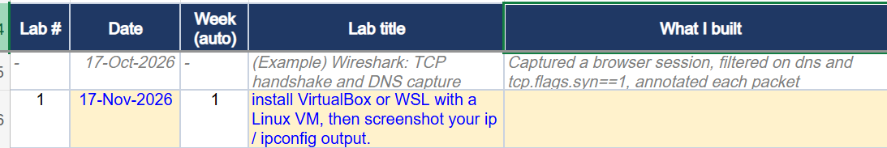

# Watching ARP and Ping in Wireshark

Until now I had only read about ARP. In this lab I installed Wireshark and watched it happen on my own network. I also made a small mistake along the way that turned into the best part of the lab.

## What I used
- Windows 11 on my home Wi-Fi (192.168.1.x)
- Wireshark 4.6.10 with Npcap
- Command Prompt (`ipconfig`, `ping`)

## Installing Wireshark
I downloaded the installer from the official site, wireshark.org, and clicked through the defaults. Two screens needed a decision:
- **USBpcap:** I left it unticked. It's experimental and only captures USB traffic, which I didn't need.
- **Npcap:** I kept it, because it's the driver that lets Wireshark see network packets. I left its three extra options unticked.

## Starting the capture
I opened Wireshark, double-clicked **Wi-Fi** in the interface list, and typed `arp || icmp` in the display filter bar. That hides everything except ARP and ping, so the list stays readable. At first the list went empty, which was expected because I hadn't sent anything yet.

## My mistake: pinging the wrong address
I ran `ipconfig` to find my gateway and then pinged an address. In Wireshark I saw both ARP and ICMP rows, but the ICMP ones said "destination unreachable", and I couldn't work out why.

When I compared the numbers properly, I had pinged **192.168.1.2, which is my own IP address**. My real gateway was **192.168.1.1**. A ping to yourself never leaves the PC, so the reply is instant and no ARP is needed. Pinging my own address told me nothing about my network.

## Pinging the real gateway
I stopped the capture, restarted it, and ran:

```
ping -n 4 192.168.1.1
```

This time Wireshark showed what I was looking for:

- **ARP request (row 144):** "Who has 192.168.1.1? Tell 192.168.1.2". My PC was shouting to everyone on the local network, asking who owns the gateway's IP.
- **ARP reply (row 145):** "192.168.1.1 is at" followed by the gateway's MAC address. The gateway answered with its hardware address.
- **ICMP rows:** the ping requests and replies that came right after. The pings worked.

ARP came first because my PC knew the gateway's IP but not its MAC. A Wi-Fi or Ethernet frame needs a MAC address to be delivered, so the PC has to turn the IP into a MAC (ARP) before it can send the ping.

## The "Port unreachable" rows
There were also some "Destination unreachable (Port unreachable)" rows in the capture. They weren't a sign that my ping failed. That message means the device is alive, but nothing is listening on the port something was sent to. Most likely some background program on my PC was sending data to a port the gateway doesn't use. The ping replies themselves were fine.

I also spotted the gateway asking my PC the same kind of ARP question in a couple of later rows. ARP goes both ways.

## Screenshots



## What I took away from this
- ARP asks "who has this IP?" and learns the matching MAC address.
- ARP only works inside the local network. It never crosses a router, and it never goes out over the internet.
- ARP always comes before the first packet to a new local address.
- A ping to my own IP answers in under 1 ms and creates no ARP traffic, so check which address you actually pinged before drawing conclusions.
- "Port unreachable" means the device is alive but nothing is listening on that port. It isn't the same as a broken network.
- A display filter like `arp || icmp` keeps a busy capture readable.

## Cleanup
I stopped the capture and didn't save the capture file, because it can contain private information. No cloud resources were created, so there was no billing risk.
