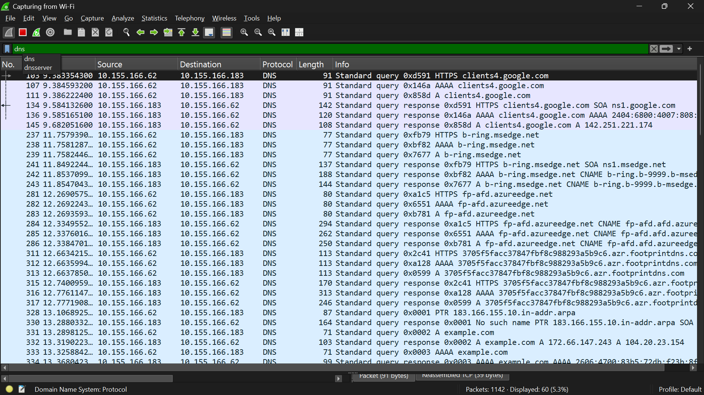
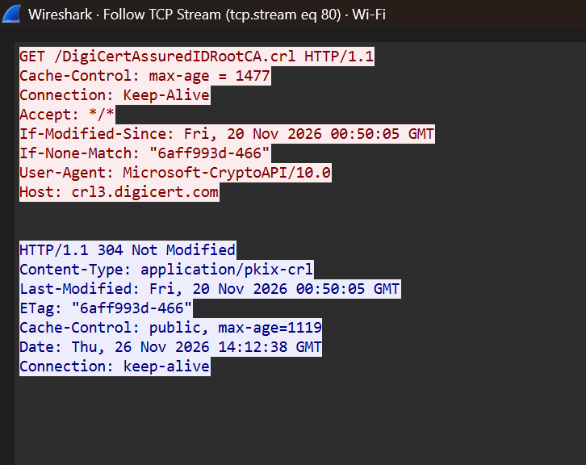

# Wireshark: DNS Query, TCP Handshake and HTTP

## Goal
Use Wireshark to watch a full web conversation from start to finish: the DNS lookup, the TCP three-way handshake, and the HTTP request and response.

## Environment
- Host OS: Windows 11, connected over Wi-Fi
- Tools: Wireshark 4.6.10, Npcap, Command Prompt (`nslookup`), browser
- Display filters used: `dns`, `tcp.flags.syn == 1`, `tcp.port == <port>`, `http.host == "example.com"`

## Architecture
```
1. DNS:   PC --UDP port 53--> DNS server: "address of example.com?"  --> answer with IPs
2. TCP:   PC --[SYN]--> Server --[SYN, ACK]--> PC --[ACK]--> connection open
3. HTTP:  PC --GET /--> Server --HTTP response--> PC
```

## Steps

### Part 1: Catch a DNS query
1. Started a capture on Wi-Fi and set the display filter to `dns`.
2. Ran `nslookup wikipedia.org` in Command Prompt.
3. Read the query and response rows in Wireshark.

### Part 2: Catch the TCP handshake
1. Changed the display filter to `tcp.flags.syn == 1`.
2. Opened `http://example.com` in the browser (plain HTTP).
3. Found the `[SYN]` and `[SYN, ACK]` rows.
4. Changed the filter to `tcp.port == <my port>` to see all three handshake steps plus the HTTP traffic that followed.

### Part 3: Follow the HTTP conversation
1. Right-clicked the `GET / HTTP/1.1` row and chose **Follow → TCP Stream**.
2. Read the request and response text.
3. Captured my own visit to example.com in an incognito window with the filter `http.host == "example.com"`.

## Screenshots




## What I found

### DNS
| Item | Value |
|---|---|
| Query | PC asks its DNS server (my gateway) for the A record of a name |
| Response | Server answers with the same transaction ID, so the answer matches the question |
| Record types | A = IPv4 address, AAAA = IPv6 address |
| Transport | UDP, destination port 53 |

### TCP three-way handshake
| Step | Info | Meaning |
|---|---|---|
| 1 | `[SYN]` | "Can we connect?" |
| 2 | `[SYN, ACK]` | "Yes, and hello to you too" |
| 3 | `[ACK]` | "Yes!" Connection is open |

My PC used a random temporary port, and the web server used port 80 (HTTP). Port 443 is HTTPS.

### HTTP
After the handshake: `GET / HTTP/1.1`, then an ACK, then the response. One page visit also triggered extra requests, such as a script file.

The first stream I followed was not my browser visit. It was Windows itself (`User-Agent: Microsoft-CryptoAPI`) checking a certificate revocation list, and the server answered `304 Not Modified`, meaning my copy was still fresh.

## What went wrong and how I fixed it

| Problem | Symptom | Cause | Fix |
|---|---|---|---|
| No capture started | Wireshark stayed on the Welcome page, filter box was red | I typed `dns` into the **capture filter** box, which uses different syntax | Cleared the red box, double-clicked Wi-Fi to start capturing, and typed `dns` in the **display filter** bar |
| Packet list stayed empty | Capture was running but no rows showed | Wireshark auto-complete changed `dns` into `dnsserver` | Retyped `dns` exactly and pressed Esc before Enter to dismiss the suggestion list |
| Followed the wrong stream | The HTTP stream showed `x1.c.lencr.org`, not example.com | Many background programs use HTTP at the same time | Used the filter `http.host == "example.com"` and an incognito window to catch only my own visit |

## What I learned
- A capture filter decides what gets recorded. A display filter hides rows afterwards. They use different syntax.
- DNS uses UDP port 53 because a lookup is a tiny question that can simply be asked again.
- A TCP connection starts with SYN, SYN-ACK, ACK. A filter on `tcp.flags.syn == 1` hides the final ACK.
- Frames are layered: Ethernet, IP, UDP or TCP, then the application (DNS or HTTP).
- A computer talks to the internet in the background all the time, so a capture shows more than my browser.
- Plain HTTP can be read like a letter, which is why HTTPS (port 443) encrypts the conversation.
- `304 Not Modified` means the browser's cached copy is still current.
- To find my own traffic in a busy capture, filter by host or port.

## Cleanup
- Stopped the capture and did not save the capture file, because it can contain private information.
- No cloud resources were created, so there is nothing to delete and no billing risk.
