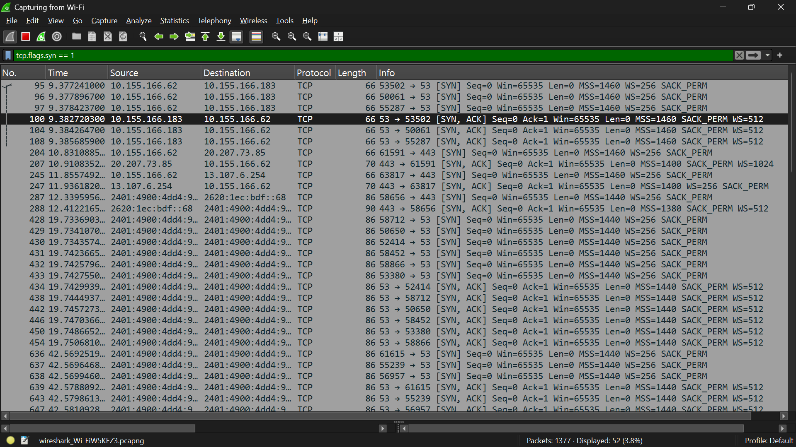

# Following a Web Visit in Wireshark: DNS, TCP Handshake and HTTP

In the last lab I watched ARP. This time I wanted to follow a whole web visit from the very first question ("what's the address of this website?") to the page coming back. It took me a few wrong turns with Wireshark's filters before it worked, and those taught me as much as the packets did.

## What I used
- Windows 11 on Wi-Fi
- Wireshark 4.6.10 with Npcap
- Command Prompt (`nslookup`) and my browser

## Part 1: Catching a DNS query

I started a capture on Wi-Fi, typed `dns` in the filter bar and ran `nslookup example.com`. The lookup itself worked fine. The answer came back with one IPv6 address and two IPv4 addresses, and it was marked "non-authoritative", which means my DNS server answered from its cache.

Wireshark, though, showed nothing. Here is what went wrong:

- **Mistake 1: wrong filter box.** I had typed `dns` into the middle box, which is the *capture* filter, and it turned red. The capture filter uses different syntax, so the capture never started and I was still looking at the Welcome page. The fix was to clear that box, double-click Wi-Fi to start capturing, and type `dns` in the green *display* filter bar at the top.
- **Mistake 2: auto-complete.** The capture was running but the list was still empty. When I read the filter bar letter by letter, Wireshark's auto-complete had changed `dns` into `dnsserver`. I retyped `dns` exactly and it worked.

I also ran `nslookup wikipedia.org` for a fresh lookup, so the cache wouldn't hide it.

Once it worked, I could see the conversation. My PC (10.155.166.62) asked its DNS server (10.155.166.183) for the **A record** of a name, and the server answered with the same transaction ID (0x4858), so the answer matched the question. There was a second pair of rows for **AAAA**, the IPv6 version. Names I hadn't asked for, like googleapis.com and windowsupdate.com, kept appearing too. Background apps use DNS all the time, not just my browser.

In the bottom pane I could see the layers stacked up: Ethernet, then IP, then UDP (destination port 53), then DNS. DNS uses **UDP port 53** because a lookup is a tiny question. If it gets lost, the PC just asks again, so it doesn't need the slow handshake that TCP does.

## Part 2: Catching the TCP handshake

I changed the display filter to `tcp.flags.syn == 1` and opened `http://example.com` in my browser, using plain HTTP on purpose so I could read it later.

Wireshark showed rows like this:

- `54965 → 80 [SYN]`: my PC saying "can we connect?" from a random temporary port (54965) to the web server's port 80
- `80 → 54965 [SYN, ACK]`: the server saying "yes, and hello to you too"

There were more pairs on port **443**, which is HTTPS. The browser opens several connections at once, so that's normal.

A handshake has three steps, but my filter only showed two. The third step, the plain `[ACK]`, doesn't have the SYN flag, so my filter was hiding it. I changed the filter to `tcp.port == 54965` and saw the whole story in order:

| Info | What it means |
|---|---|
| `[SYN]` | "Can we connect?" |
| `[SYN, ACK]` | "Yes, can you hear me?" |
| `[ACK]` | "Yes!" The handshake is done |
| `GET / HTTP/1.1` | "Please send me the home page" |
| `[ACK]` | "Got your request" |
| `HTTP/1.1 304 Not Modified` | "You already have the latest copy" |

The 304 means my browser had kept an old copy of the page, and the server confirmed it was still fresh, so nothing needed to be sent again.

## Part 3: Following the stream, and the surprise

I right-clicked the `GET /` row and chose **Follow, then TCP Stream**. The host line said `x1.c.lencr.org`, not example.com. I had followed the wrong conversation.

It turned out to be Windows itself. The request had `User-Agent: Microsoft-CryptoAPI/10.0` and a content type of `application/pkix-crl`, which is Windows checking a list of security certificates that are no longer trusted. The server answered 304 again, because Windows already had the latest list. So my computer talks to the internet in the background all the time, and Wireshark shows all of it.

Because this was plain HTTP, I could read the whole thing like a letter. That is exactly why HTTPS exists: it puts the letter in a locked envelope.

## Catching my own visit
To find my own visit, I filtered on the website name instead:

```
http.host == "example.com"
```

I opened `http://example.com` in an incognito window, so the cache couldn't hide it. This time I caught my own `GET /` row, and right after it a `GET /s.js` row. One page often asks for extra files like scripts, images and styles. The page text appeared in another language, but that was just my browser's auto-translate, not something on the network.

## Screenshots




## Problems and how I fixed them

| Problem | What I saw | Cause | Fix |
|---|---|---|---|
| Capture wouldn't start | Welcome page, red filter box | I typed `dns` in the capture filter box | Cleared it, started the capture, typed `dns` in the display filter |
| Empty packet list | Capture running, no rows | Auto-complete turned `dns` into `dnsserver` | Retyped `dns` and pressed Esc before Enter |
| Followed the wrong stream | Host was `x1.c.lencr.org` | Windows sends background HTTP traffic too | Filtered by `http.host == "example.com"` and used an incognito window |

## What I took away from this
- A **capture filter** decides what gets recorded. A **display filter** hides rows afterwards. They use different syntax.
- DNS uses UDP port 53, because a lookup is a tiny question that can simply be asked again.
- A TCP connection starts with SYN, SYN-ACK, ACK. A filter on `tcp.flags.syn == 1` hides the last ACK.
- Every packet is layered: Ethernet, IP, UDP or TCP, then the application like DNS or HTTP.
- To find my own traffic in a busy capture, filter by host or port.
- Plain HTTP can be read by anyone on the path, and HTTPS (port 443) encrypts it.

## Cleanup
I stopped the capture and didn't save the capture file, because it can contain private information from background apps. No cloud resources were created, so there was no billing risk.
