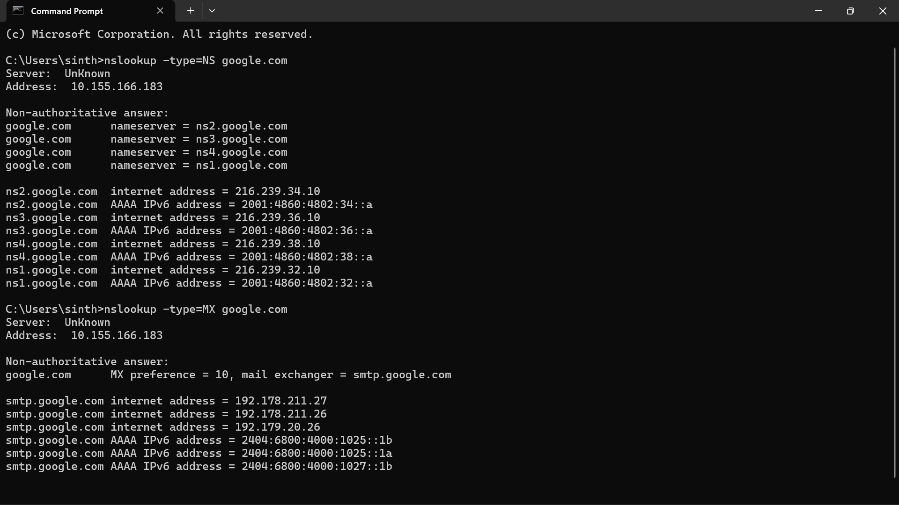

# Exploring DNS Records with nslookup

In the Wireshark lab I saw my PC asking DNS for A and AAAA records. This time I wanted to ask the questions myself and see what else DNS knows about a domain: who runs its name servers, where its email goes, and whether a name is just an alias for another one.

## What I used
- Windows 11, Command Prompt with `nslookup`
- My gateway as the DNS server. Every answer said "non-authoritative", which means it came from a cache, not from the domain's own server.

## Name servers (NS)
I started with `nslookup -type=NS google.com`. It returned four servers: ns1, ns2, ns3 and ns4 .google.com, each with its own IPv4 and IPv6 address.

These are the domain's authoritative servers, the ones that officially own the answers. There are four so that if one is down, another can still answer.

## Mail servers (MX)
Next was `nslookup -type=MX google.com`. The result was `MX preference = 10, mail exchanger = smtp.google.com`, followed by several addresses for that mail server.

I guessed that the number was a priority, and that's right: the **lower number is tried first**. If a domain had one server at 10 and another at 20, mail would go to the 10 first and use the 20 as a backup. The mail server name also has its own A and AAAA records, because an MX record has to point to a name, not straight to an IP.

## An alias (CNAME)
In my Wireshark lab I had seen a name that kept pointing somewhere else, so I looked it up: `nslookup -type=CNAME x1.c.lencr.org`. The answer was a long different name, shown as `canonical name`.

A CNAME is a nickname. It points to another name, never directly to an IP. The resolver follows the chain: nickname, then real name, then A record, then IP. Companies use aliases so they can move a server and change only one real record, and every nickname follows it.

## Trying it on a real site: ndl.gov.in
For the second part I picked three sites I'm familiar with: the National Digital Library of India, Meesho and Park+. I started with the library, `ndl.gov.in`, and ran three lookups:

- **NS:** two servers, ns01 and ns02. That's a backup pair.
- **MX:** `preference = 1, smtp.google.com`. So the library's email runs on Google's mail servers, which I wouldn't have guessed.
- **CNAME:** no alias. Instead of an alias, I got a "primary name server" line.

I was confused here. I couldn't see a CNAME and I couldn't see any IP address. The reason is that `-type=CNAME` only shows alias records. `ndl.gov.in` is a main domain, and main domains usually have plain A records instead, so the lookup said "no alias here" and told me who is in charge of the domain.

To get the IP addresses, I ran the lookups without `-type` (the default asks for A records).

## Comparing three domains
| Domain | IPs returned | Notes |
|---|---|---|
| meesho.com | 1 (IPv4) | A single address |
| ndl.gov.in | 2 (IPv4) | Two addresses |
| parkplus.io | 4 (2 IPv4 and 2 IPv6) | The most addresses |

Park+ had the most. Sites often have several IPs for backup and for sharing the load between servers. If one server is busy or down, others can answer.

## Screenshots

## The one thing that tripped me up

| Problem | What I saw | Cause | Fix |
|---|---|---|---|
| No IP address in the result | `nslookup -type=CNAME ndl.gov.in` printed only a name server | `-type=CNAME` shows only aliases, and this domain has none | Ran `nslookup ndl.gov.in` without `-type` to get the A records |

## What I took away from this
- NS records name the servers in charge of a domain, and having several gives backup.
- MX records say where email goes, and a lower preference number is tried first.
- A CNAME is an alias, and the resolver follows it to the real name and then to the IP.
- A main domain normally has an A record, not a CNAME.
- Asking for a specific `-type` shows only that record type, so asking for the wrong one can make it look like nothing exists.
- "Non-authoritative answer" means the reply came from a cache.
- Several IP addresses for one name give backup and load sharing.

## Cleanup
Nothing to delete. I didn't create any cloud resources, so there was no billing risk.
