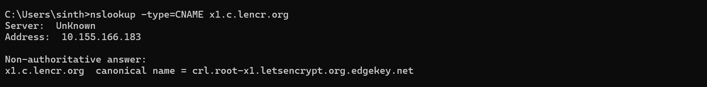
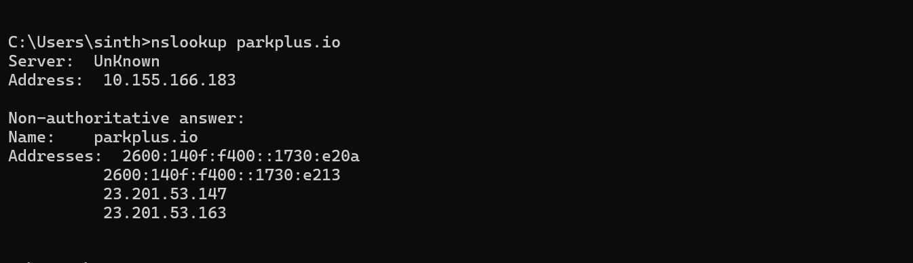

# DNS Records with nslookup (NS, MX, CNAME, A, AAAA)

## Goal
Use `nslookup` to look up the main DNS record types on real domains, and learn what each record tells you.

## Environment
- Host OS: Windows 11, connected over Wi-Fi
- Tool: Command Prompt with `nslookup`
- DNS server used: my gateway (the answers were "non-authoritative", so they came from a cache)

## Architecture
```
PC --> local DNS server (gateway/cache) --> authoritative name servers --> answer
```

## Steps
1. Looked up the name servers: `nslookup -type=NS google.com`
2. Looked up the mail servers: `nslookup -type=MX google.com`
3. Looked up an alias: `nslookup -type=CNAME x1.c.lencr.org`
4. Ran NS, MX and CNAME lookups on `ndl.gov.in`.
5. Looked up the plain address records (A and AAAA) for three domains: `nslookup ndl.gov.in`, `nslookup meesho.com`, `nslookup parkplus.io`

## Screenshots




## What I found

### Record types

| Record | Command | Result | Meaning |
|---|---|---|---|
| NS | `nslookup -type=NS google.com` | ns1, ns2, ns3, ns4 .google.com | The four authoritative name servers, kept for backup |
| MX | `nslookup -type=MX google.com` | preference 10, smtp.google.com | Where email is delivered. A lower preference number is tried first |
| CNAME | `nslookup -type=CNAME x1.c.lencr.org` | canonical name = a longer real name | An alias (nickname) that points to another name, never directly to an IP |
| A | `nslookup <domain>` | IPv4 addresses | Name to IPv4 address |
| AAAA | shown in the same lookup | IPv6 addresses | Name to IPv6 address |

### Three domains compared

| Domain | IP addresses returned | Notes |
|---|---|---|
| meesho.com | 1 (IPv4) | Single address |
| ndl.gov.in | 2 (IPv4) | Two addresses |
| parkplus.io | 4 (2 IPv4 + 2 IPv6) | The most addresses |

### Extra finding: ndl.gov.in
- NS: two name servers (ns01 and ns02), a backup pair
- MX: preference 1, handled by smtp.google.com, so their email runs on Google's mail servers

## What went wrong and how I fixed it

| Problem | Symptom | Cause | Fix |
|---|---|---|---|
| No IP address shown | `nslookup -type=CNAME ndl.gov.in` printed "primary name server" and no address | `-type=CNAME` only shows aliases, and `ndl.gov.in` has no alias | Ran `nslookup ndl.gov.in` without `-type` to get the A records |

## What I learned
- NS records name the servers in charge of a domain. Having several gives backup.
- MX records say where email goes. A lower preference number is tried first, and the higher numbers are backups.
- A CNAME is an alias. The resolver follows it to the real name, then to the IP.
- A main domain usually has an A record, not a CNAME.
- `-type=CNAME` shows only CNAME records, so asking for the wrong type makes it look like nothing exists.
- "Non-authoritative answer" means the reply came from a cache, not from the domain's own server.
- Several IP addresses for one name give backup and load sharing.
- A mail server name must point to a name with an A or AAAA record, not directly to an IP.

## Cleanup
- No cloud resources were created, so there is nothing to delete and no billing risk.
