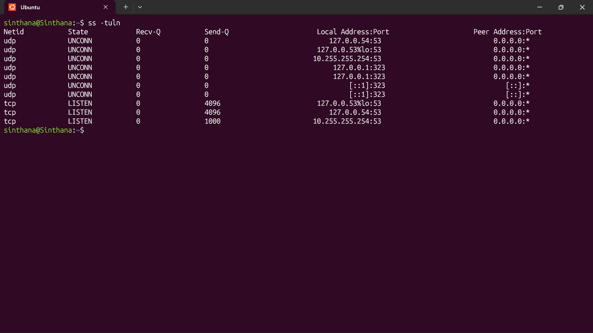

# Checking What's Listening on My Linux Machine with `ss`

Every open port is a door that something could knock on. In this lab I wanted to see which doors my Ubuntu machine actually has open, work out what is behind each one, and practise matching common port numbers to the services that use them.

## What I used
- Ubuntu on WSL2 (running on Windows 11)
- `ss -tuln`

## Listing the open ports
I opened Ubuntu and ran:

```
ss -tuln
```

The flags are easy to remember once you know them: `-t` for TCP, `-u` for UDP, `-l` for listening only, and `-n` to show numbers instead of names.

## What I found
The output had ten rows, and only two port numbers showed up:

| Port | Protocol | Local address | What it is |
|---|---|---|---|
| 53 | UDP and TCP | 127.0.0.53, 127.0.0.54, 10.255.255.254 | A small DNS helper running inside my VM |
| 323 | UDP | 127.0.0.1 and ::1 | Probably the time-sync service. I guessed this from the port number and didn't verify which program it is |

A few things I learned from reading the columns:

- **UNCONN** (for UDP) and **LISTEN** (for TCP) both mean the same thing: waiting for visitors.
- **0.0.0.0:*** under Peer Address means nobody is connected right now, and anyone may connect.
- The address 10.255.255.254 looked familiar. I had already seen it on the `lo` interface in my very first `ip a` output.

I also noticed what was **missing**. Ports 22 (SSH), 80 (HTTP) and 443 (HTTPS) weren't listening, so my VM isn't running an SSH server or a web server. That's a good thing. The fewer doors that are open, the smaller the attack surface.

## Can someone else reach these ports?
Almost all the addresses start with **127**. That's the loopback range, which only works inside the same computer, like talking into a mirror. So no, another computer on my Wi-Fi can't connect to `127.0.0.53:53`. It's only for programs on this machine.

## Where I slipped
When I was asked which service port 53 belongs to, I answered "UDP". That's true, but it's the protocol, not the service. The service is **DNS**.

- **Protocol** is how the data travels: TCP or UDP.
- **Service** is what the program does: DNS, web, SSH.

## Matching ports to services
I also practised the ports that come up most often, and I got all four right:

| Port | Service | A way to remember it |
|---|---|---|
| 22 | SSH | The secure remote terminal |
| 53 | DNS | Name lookups |
| 80 | HTTP | Plain web |
| 443 | HTTPS | Secure web |
| 3389 | RDP | Windows remote desktop |

## Screenshot


## What I took away from this
- `ss -tuln` is a quick way to see what a machine is offering to the network.
- A protocol (TCP or UDP) is how data travels. A service (DNS, SSH, web) is what the program does.
- Loopback addresses (127.x.x.x) can only be reached from the same machine.
- Checking for ports that shouldn't be open is a basic security habit.

## Cleanup
Nothing to delete. I didn't create any cloud resources, so there was no billing risk.
