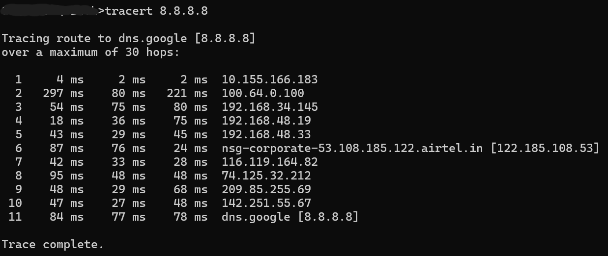
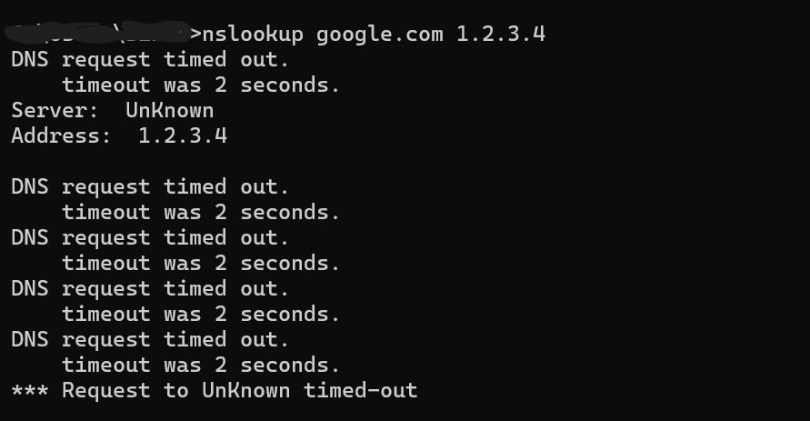
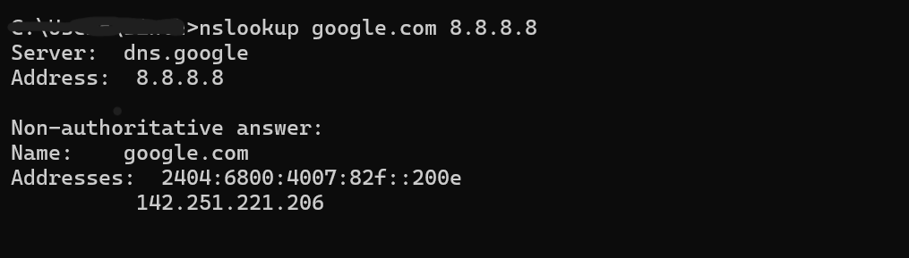
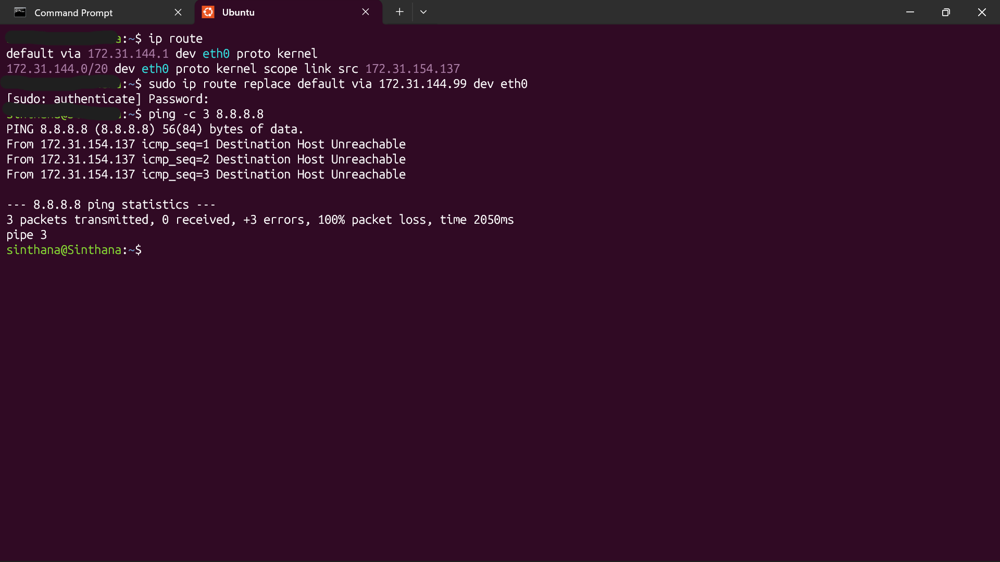
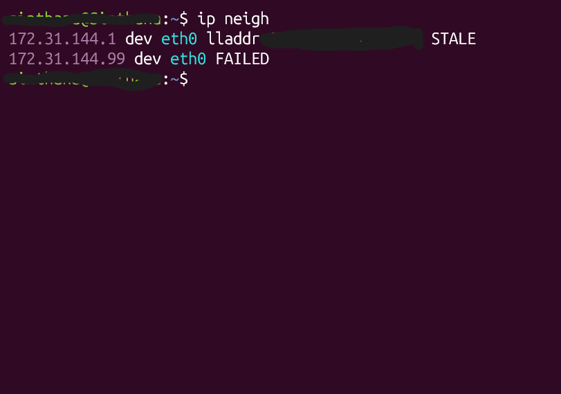
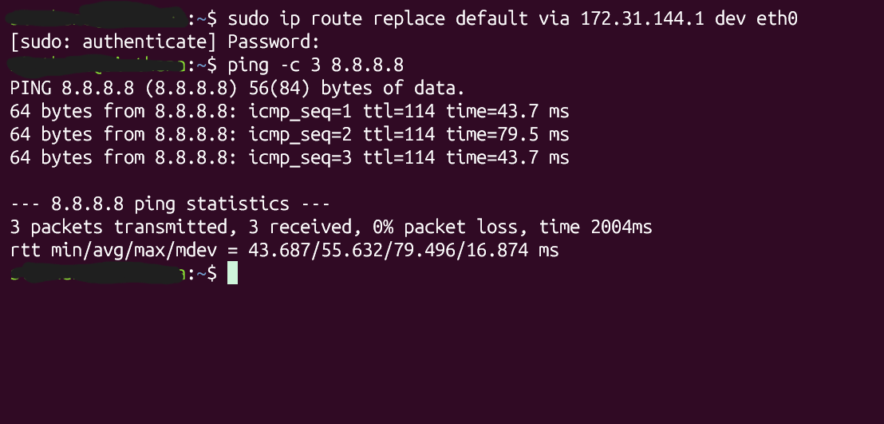

# Breaking My Network on Purpose (and Fixing It)

The best way to learn troubleshooting is to break something safely and then work out what went wrong. In this lab I read a traceroute, broke DNS on purpose, and then broke the default gateway on my Linux machine. I used the evidence each time to find the cause before fixing it.

## What I used
- Windows 11 (Command Prompt), connected through a mobile hotspot
- Ubuntu on WSL2
- `tracert`, `nslookup`, `ip route`, `ping` and `ip neigh`

## Part 1: Reading a traceroute
I started with `tracert 8.8.8.8` to see the path my traffic takes to Google's DNS.

- **Hop 1 (10.155.166.183)** was my own gateway, the hotspot.
- **Hop 2 (100.64.0.100)** was where my traffic enters the carrier's network. The 100.64.x.x range is a special shared range used by mobile and internet providers (CGNAT).
- **Hops 3 to 5 (192.168.x.x)** were private addresses inside the provider's network. Big networks use private addresses internally too.

Hop 2 was the slowest, at around 200 to 290 ms. My first guess was that it was normal, and that turned out to be right. The hops after it were much faster (33 to 58 ms), so the packets weren't getting stuck. That router was probably just slow to answer probes, or it was the mobile radio link. One slow hop in the middle doesn't mean a fault. What matters is the final hop and whether the numbers stay high.

## Part 2: Breaking DNS
I didn't want to touch my Wi-Fi settings, so I asked a made-up DNS server instead:

```
nslookup google.com 1.2.3.4
nslookup google.com 8.8.8.8
```

The first one failed. I got "DNS request timed out" several times and then "Request to UnKnown timed-out", because nothing was answering at 1.2.3.4. The second one, using Google's real DNS, came back straight away with IP addresses for google.com.

So a DNS failure looks like a timeout, and the fix is to use a DNS server that actually works.

## Part 3: Breaking the default gateway
This one I did inside my Ubuntu VM, where it was safe and easy to undo.

1. **Write down the original.** `ip route` showed `default via 172.31.144.1 dev eth0`. I saved this first so I could restore it later.
2. **Check that it works.** `ping -c 2 8.8.8.8` was fine.
3. **Break it.** I pointed the default route at an address that doesn't exist on my network:
   ```
   sudo ip route replace default via 172.31.144.99 dev eth0
   ping -c 3 8.8.8.8
   ```
4. **Look at the symptoms.** Every ping failed with "Destination Host Unreachable" and 100% packet loss.

The clue that made me stop and think was where the error came from: **my own IP address** (172.31.154.137), not a router out on the internet. My VM tried to hand the packet to the gateway at .99, and nobody answered.

## Proving it with ARP
To be sure, I checked the neighbour table with `ip neigh`. It had two lines:

- `172.31.144.99 dev eth0 FAILED`: my VM asked "who has .99?" and nobody replied. That's the broken gateway.
- `172.31.144.1 dev eth0 lladdr ... STALE`: the real gateway, still remembered from before.

That settled it. The problem was on my own network segment, not somewhere further down the path.

## The fix
I restored the real gateway and tested again:

```
sudo ip route replace default via 172.31.144.1 dev eth0
ping -c 3 8.8.8.8
```

This time the pings came back with 0% packet loss.

## Screenshots







## Problems and how I diagnosed them

| Problem | Symptom | Evidence | Fix |
|---|---|---|---|
| Wrong DNS server | `DNS request timed out` | No answer from 1.2.3.4 | Use a working DNS server like 8.8.8.8 |
| Wrong default gateway | `Destination Host Unreachable`, 100% loss | Error came from my own IP, and `ip neigh` showed FAILED for the fake gateway | Set the default route back to 172.31.144.1 |

## What I took away from this
- One slow hop in a traceroute isn't a verdict. Look at whether the last hops stay slow.
- 100.64.x.x addresses mean the carrier is sharing public addresses between customers.
- "Destination Host Unreachable" from **my own IP** points to a problem on my local network, like a wrong gateway. If it came from a router's IP, the problem would be further along the path.
- `ip neigh` showing FAILED proves nobody answered the ARP request.
- Always write down the original settings before breaking anything, so you can put them back.

## Cleanup
I restored the original default route and confirmed 0% packet loss. If anything had gone wrong, `wsl --shutdown` in PowerShell would have reset the VM. No cloud resources were created, so there was no billing risk.
