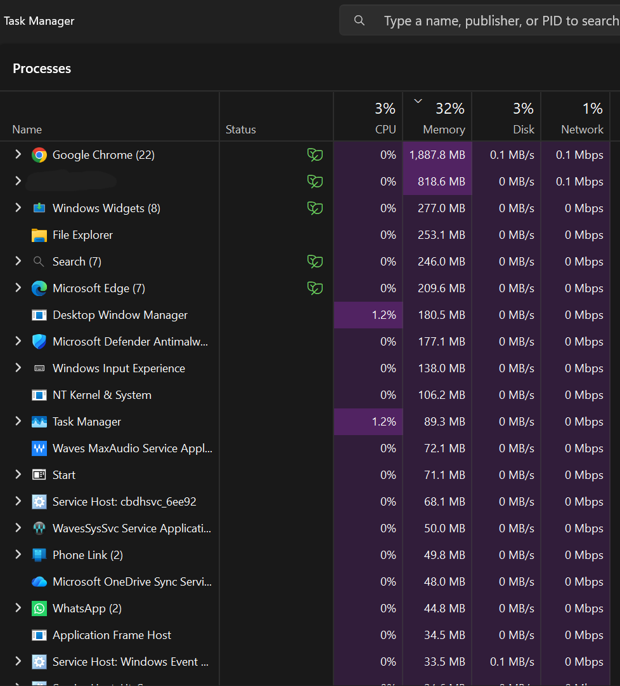
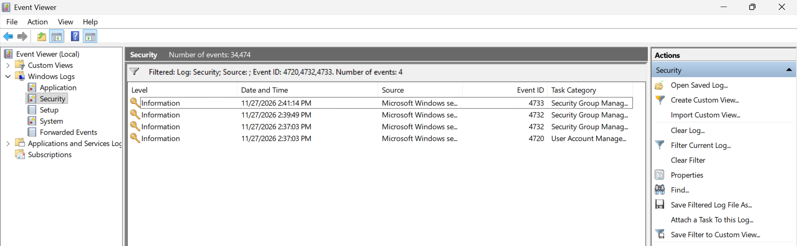

# Windows Administration Basics: Task Manager, Services, Users and Event Viewer

## Goal
Practise the everyday Windows admin tasks a support engineer does: checking running processes, reading service status, creating and changing a user account, and proving who changed what from the Event Viewer logs.

## Environment
- Host OS: Windows 11
- Tools: Task Manager, `services.msc`, Command Prompt (run as administrator), `net user`, `net localgroup`, Event Viewer (`eventvwr.msc`)
- Test account: `labuser` (created for this lab and deleted at the end)

## Steps

### Part 1: Task Manager
1. Opened Task Manager (Ctrl + Shift + Esc) and sorted the Processes tab by the Memory column.
2. The highest memory user was Windows Widgets, at about 270 MB. That is normal for a built-in background feature.

### Part 2: Services
1. Opened `services.msc` and found **DHCP Client**.
2. Status: **Running**. Startup type: **Automatic**.
3. This service asks the DHCP server for the PC's IP settings, so other services that depend on networking can fail if it stops.

### Part 3: Create a test user and change its permissions
1. Created a standard test user (the password prompt hides what I type):
   ```
   net user labuser * /add
   net user labuser
   ```
   The account was active and a member of the **Users** group only.
2. Promoted it to administrator and listed the group:
   ```
   net localgroup Administrators labuser /add
   net localgroup Administrators
   ```
3. Took the powers back (least privilege):
   ```
   net localgroup Administrators labuser /delete
   net localgroup Administrators
   ```
   `labuser` was gone from the list.

### Part 4: Prove it in Event Viewer
Opened Event Viewer, then Windows Logs, then Security, then Filter Current Log with Event IDs `4720,4732,4733`.

| Time | Event ID | What happened |
|---|---|---|
| 2:37:03 PM | 4720 | Account created |
| 2:37:03 PM | 4732 | Automatically added to the Users group at creation |
| 2:39:49 PM | 4732 | **My** promotion of `labuser` to Administrators |
| 2:41:14 PM | 4733 | Removed from Administrators |

The creation time also matched the "Password last set" time shown by `net user`, so the log and the account agree.

### Part 5: Cleanup
Deleted the test account with `net user labuser /delete`, so the PC has only my own accounts again.

## Screenshots





## What I found

| Item | Result |
|---|---|
| Highest memory use | Windows Widgets, about 270 MB (normal) |
| DHCP Client | Running, Automatic |
| New account's group | Users (standard user) |
| Event 4720 | Account created |
| Event 4732 | Member added to a group |
| Event 4733 | Member removed from a group |

Service startup types: **Automatic** starts at boot, **Manual** starts only when needed, **Disabled** cannot start.

## Troubleshooting approach: "My PC became slow this morning"
- **Task Manager:** sort by CPU, Memory and Disk to find the process using too much. Check the Startup apps tab for programs that start at boot. End a misbehaving app that isn't needed.
- **Event Viewer (Windows Logs, System and Application):** look for Error and Warning events around the time the slowness began, such as disk errors or crashing services.

## What I learned
- The DHCP Client service receives IP settings from the DHCP server. The PC does not assign its own address.
- A new account starts in the **Users** group, which cannot change system settings.
- **Least privilege:** give admin rights only when needed. If everyone is an admin, one mistake or one piece of malware can damage the whole PC.
- Event Viewer proves who changed what and when. Matching the **time and the Event ID together** tells you which event is yours.
- Never end unknown system processes in Task Manager. Use End task only on normal apps.
- Never type or share real passwords in notes or chats. For a test account, use a throwaway password.

## Cleanup
- Deleted the test user `labuser`.
- No cloud resources were created, so there is nothing else to delete and no billing risk.
