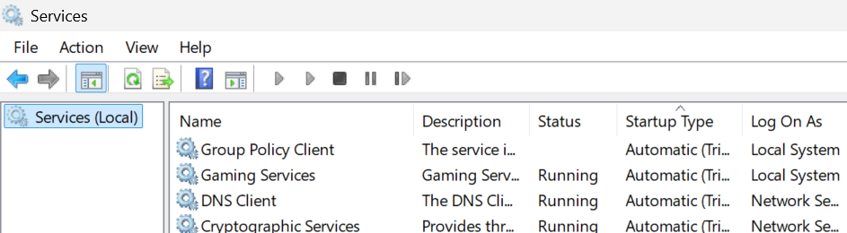
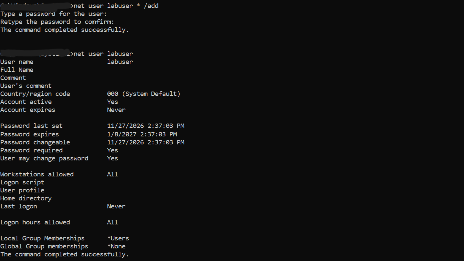
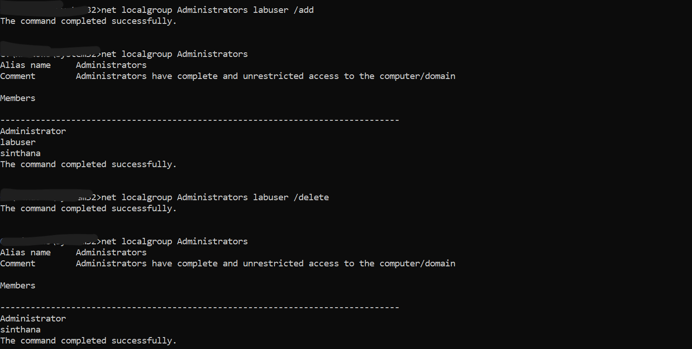

# Windows Admin Basics: Processes, Services, Users and the Event Viewer

A lot of support work on Windows comes down to a few questions. What is running? Is the service I need healthy? Who has permission to do what? And when something changed, who did it? In this lab I worked through each of those on my own PC, using a throwaway test account so I wouldn't touch my real one.

## What I used
- Windows 11
- Task Manager, `services.msc`, Command Prompt (run as administrator), Event Viewer
- A test account called `labuser`, which I deleted at the end

## Looking at what's running
I opened Task Manager with Ctrl + Shift + Esc, went to the Processes tab and sorted by the Memory column. The biggest user was **Windows Widgets**, the news and weather panel, at about 270 MB. That looked alarming at first, but it's normal for a built-in feature that runs in the background.

I also learned a safety rule here. It's fine to right-click a normal app and choose **End task**, but never end system processes you don't recognise.

## Checking a service
Next I opened `services.msc` and found **DHCP Client**. Its status was **Running** and its startup type was **Automatic**, which is what a healthy service should look like.

The three startup types are easy to mix up:
- **Automatic** starts by itself when the PC boots.
- **Manual** starts only when something needs it.
- **Disabled** can't start at all.

I explained that the DHCP Client assigns the IP settings, but that wasn't quite right. The PC doesn't assign its own address. The DHCP Client service *asks for and receives* the settings from the DHCP server. My point about dependencies was correct though: if this service stops, other services that rely on the network can fail too.

## Creating a test user
Using an administrator Command Prompt, I created a standard account:

```
net user labuser * /add
net user labuser
```

The `*` makes Windows ask for the password instead of showing it on screen, and I used a throwaway one. The details showed that the account was active, the password would expire in 42 days (Windows' default), nobody had logged in yet, and the only group it belonged to was **Users**. That's a standard account, which can run apps but can't change system settings.

## Giving it admin powers, then taking them back
I added the account to the Administrators group and listed the members:

```
net localgroup Administrators labuser /add
net localgroup Administrators
```

The list showed the built-in Administrator account, `labuser` and my own account. So `labuser` was now an admin.

Then I took the powers back right away:

```
net localgroup Administrators labuser /delete
net localgroup Administrators
```

`labuser` was gone from the list. This is the idea of **least privilege**: give someone only the rights they need. If everyone is an administrator, one mistake (like deleting a system file) or one piece of malware running with their rights can damage the whole PC.

## Finding my own footprints in Event Viewer
Everything I'd just done had been written down. I opened `eventvwr.msc`, went to Windows Logs, then Security, chose **Filter Current Log**, and typed these event IDs: `4720,4732,4733`.

- 4720 means a user account was created
- 4732 means a member was added to a group
- 4733 means a member was removed from a group

Four events appeared:

| Time | Event ID | What happened |
|---|---|---|
| 2:37:03 PM | 4720 | Account created |
| 2:37:03 PM | 4732 | Windows automatically added the new account to the Users group |
| 2:39:49 PM | 4732 | **My** promotion of `labuser` to Administrators |
| 2:41:14 PM | 4733 | I removed it from Administrators |

I got a question wrong here. When I was asked which 4732 was mine, I pointed at the 4720 row, which is the account creation. The way to read it is to match the **time and the ID together**. My promotion came a couple of minutes after creating the account, so it was the later 4732 at 2:39:49.

I also noticed that 2:37:03 matched the "Password last set" time in the `net user` output. The log and the account agreed with each other, which is exactly why logs can be trusted as proof of who changed what and when.

## Cleaning up
I deleted the test account:

```
net user labuser /delete
```

so my PC has only my own accounts again.

## A troubleshooting question: "My PC became slow this morning"
I was asked how I'd investigate a slow PC. My first answer named the two right tools but was too general. The more complete version is:

- **Task Manager:** sort by CPU, Memory and Disk to find the process using too much. Check the Startup apps tab for programs that start at boot. Use End task on an unneeded app that is misbehaving.
- **Event Viewer (Windows Logs, System and Application):** look for Error and Warning events around the time it became slow, such as disk errors or crashing services.

In one sentence: I'd open Task Manager to see which process uses too much CPU, memory or disk, then check the System log in Event Viewer for errors near the time it became slow.

## Screenshots






## What I took away from this
- The DHCP Client service receives IP settings from the DHCP server. The PC doesn't assign its own.
- A new account starts in the Users group, which can't change system settings.
- Least privilege: give admin rights only when needed.
- Event Viewer shows who changed what and when. Match the time and the event ID together to find your own events.
- Never end unknown system processes in Task Manager.
- Never type or share real passwords. A test account needs only a throwaway one.

## Cleanup
I deleted the test user `labuser`. No cloud resources were created, so there was no other cleanup and no billing risk.
